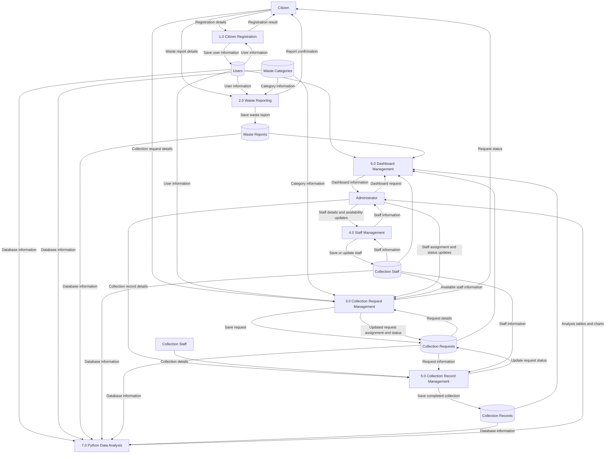

# DATA FLOW DIAGRAM – LEVEL 1

## Waste Collection Management System

The Level 1 DFD explains the internal processes of the Waste Collection Management System and the flow of information between users, application processes, and database storage.

## Description

1. Citizen Registration stores citizen details.
2. Waste Reporting stores information about waste disposal problems.
3. Collection Request Management handles collection requests, assignments, and statuses.
4. Staff Management maintains staff details and availability.
5. Collection Record Management stores completed collection details.
6. Dashboard Management retrieves information for the administrator.
7. Python Data Analysis reads database information and generates analytical charts.

The Python analysis process reads the database for analysis; it does not update the database.
