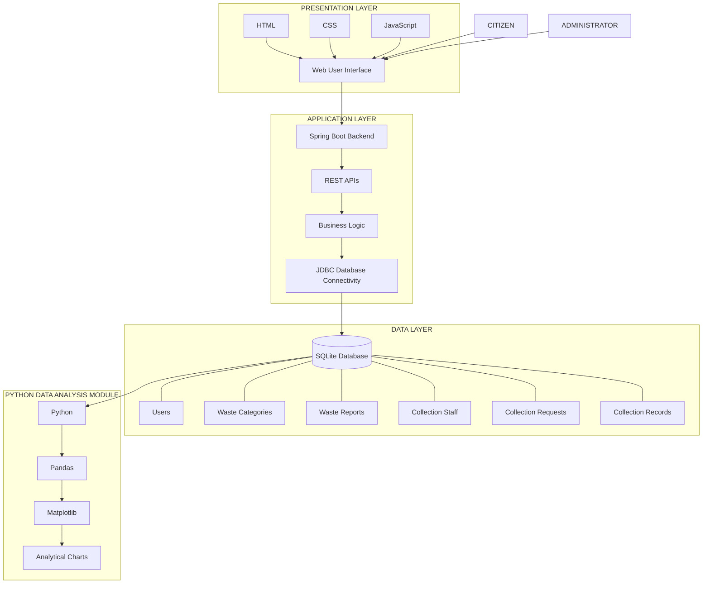

# SYSTEM ARCHITECTURE DIAGRAM

## Waste Collection Management System

The system follows a three-tier architecture consisting of the Presentation Layer, Application Layer, and Data Layer. A separate Python Data Analysis Module reads information from the SQLite database and generates analytical charts.



## Architecture Description

1. Citizens and administrators interact with the web interface.
2. The presentation layer is developed using HTML, CSS, and JavaScript.
3. The Spring Boot backend processes application requests.
4. REST APIs handle communication between the frontend and backend.
5. JDBC connects the backend to the SQLite database.
6. SQLite stores user, waste, staff, request, and collection information.
7. The Python analysis module reads data from SQLite.
8. Pandas processes the data and Matplotlib generates analytical charts.
```

Save using `Ctrl + S`.

Tell me `done` when saved. We'll continue with the remaining project documentation updates.